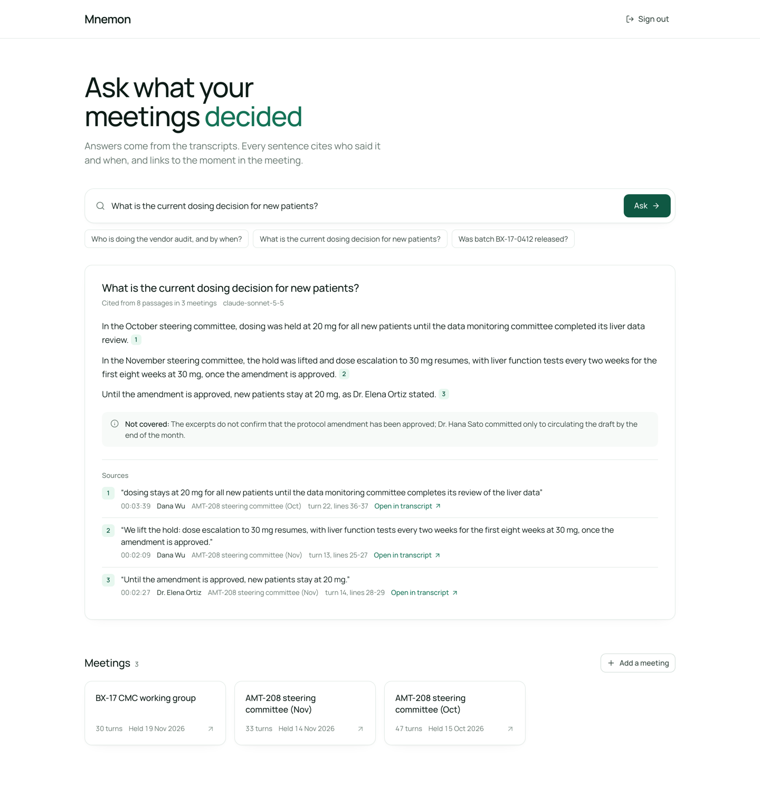
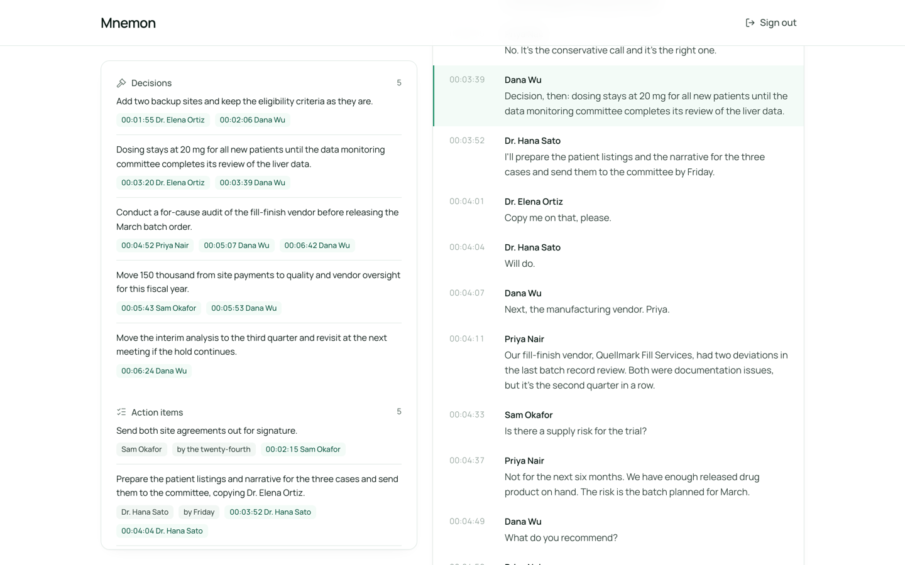
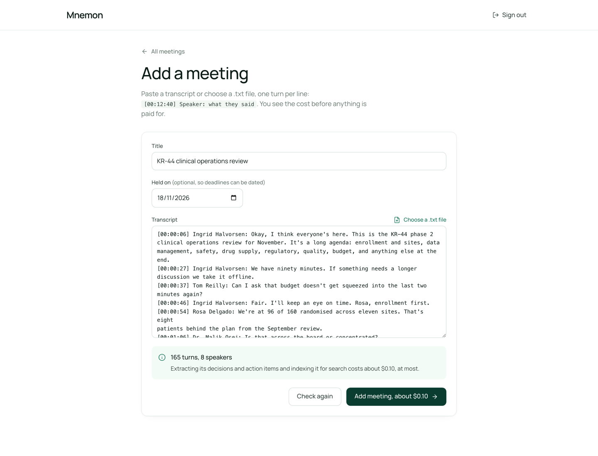
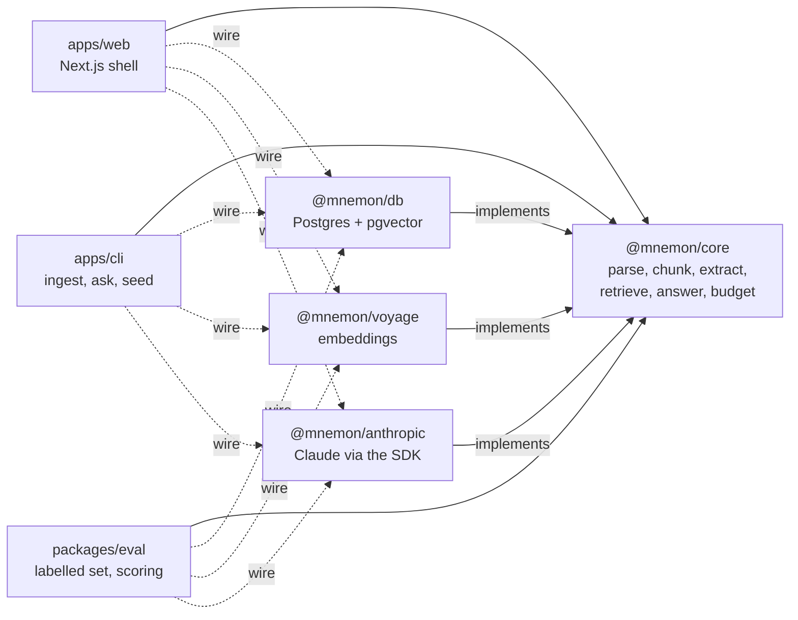
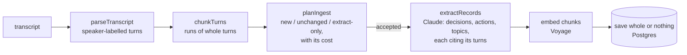
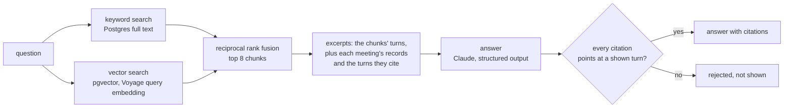

# Mnemon

Ask questions about your meetings — decisions, action items, who said what —
and get answers that cite the exact moment in the transcript.

Built for teams in regulated settings, where an answer has to trace back to who said
it and when: every sentence of an answer cites a turn, and an answer whose citations
don't check out is not shown.



| Open a citation: the cited turn, beside the meeting's records | Add a meeting: its cost is shown before anything is paid for |
| --- | --- |
|  |  |

Screenshots from the production build, signed in, over the seeded demo meetings.
The sign-in page is in [docs/screenshots/login.png](docs/screenshots/login.png).

## Try it live

**https://mnemon-topaz.vercel.app**: sign in with the access code you were given. It
runs on our API keys over the synthetic demo meetings; each code has $2 a day to spend,
and the whole demo $10 a day (ADR-0016). Everyone with a code shares one workspace, so
add only synthetic transcripts. To run your own copy instead, see the Quickstart.

## Quickstart

Needs Docker (with Compose 2.24 or later) and two API keys: Voyage AI
(https://dashboard.voyageai.com) and Anthropic (https://platform.claude.com/settings/keys).

```sh
cp .env.example .env        # then add MNEMON_VOYAGE_API_KEY and MNEMON_ANTHROPIC_API_KEY
scripts/app.sh up --seed    # build, migrate, load three synthetic meetings, start
```

`up` builds the images, starts Postgres, applies migrations, then starts the app and
waits until it answers. `--seed` shows what the demo meetings cost (up to ~$0.20,
~$0.07 in practice) and asks before loading them. It ends with a summary:

```text
Mnemon is running
  App        http://localhost:3000
  Sign in    f807-2c4e-6924  (generated; set MNEMON_ACCESS_CODE in .env to choose your own)
  Meetings   3 stored
  Database   localhost:54320 (user mnemon, password mnemon)
  Logs       scripts/app.sh logs
  Stop       scripts/app.sh down
```

Try "What is the current dosing decision for new patients?" (it spans two meetings,
the second reversing the first), then open a source to land on the turn it cites.

**Ports.** If 3000 or 54320 is taken, `up` uses the next free port and says so, and
moves again if another program takes a port while it starts. To choose: `--web-port
8080 --db-port 55432`, or `MNEMON_WEB_PORT` and `MNEMON_DB_PORT` in the shell or `.env`.

**By hand.** The script wraps plain Compose; everything it does can be run directly:

```sh
docker compose --profile app up -d --build    # db, then migrate, then web on :3000
docker compose --profile app run --rm migrate node apps/cli/src/seed.ts --yes
docker compose --profile app logs -f web
docker compose --profile app down             # data stays in the mnemon-db volume
```

Set `MNEMON_ACCESS_CODE` in `.env` first when starting by hand: the container runs in
production mode, which refuses everyone without one. Other commands: `scripts/app.sh
help`, or `pnpm app:up`, `app:seed`, `app:logs`, `app:down`.

A Voyage account with no payment method is limited to 3 requests a minute, and each
question and each seeded meeting is one request. Mnemon waits out the limit rather
than fail, so a question asked right after seeding can take up to a minute. Adding a
payment method lifts the limit; the first 200M tokens stay free.

## Architecture

All behaviour lives in `@mnemon/core`, which imports no framework, database or API
client. It defines small interfaces (`MeetingRepository`, `ChunkSearch`, `Embedder`,
`LanguageModel`, `SpendLedger`) and the adapters implement them. The web app, the CLI
and the eval are composition roots that wire the same core to the same adapters, so
the eval measures the code the app runs.



**Adding a meeting.** Nothing is paid for until the plan has been priced and accepted.



**Asking a question.**



Where to read each part:

| Part | Code | Decision |
| --- | --- | --- |
| Transcript format and parsing | `packages/core/src/transcript` | ADR-0002 |
| Chunking | `packages/core/src/chunking` | ADR-0003 |
| Storage and search SQL | `packages/db/src`, `packages/db/migrations` | ADR-0004 |
| Hybrid retrieval | `packages/core/src/retrieval` | ADR-0005 |
| Record extraction (prompt, schema) | `packages/core/src/extraction` | ADR-0006, ADR-0013 |
| Answers and citation checks (prompt, schema) | `packages/core/src/answering` | ADR-0007, ADR-0011, ADR-0012 |
| Model choice, settled by the eval | `packages/anthropic/src`, `packages/eval` | ADR-0008 |
| Web shell, sign-in gate, access codes | `apps/web` | ADR-0009, ADR-0010, ADR-0016 |
| Hosted demo (Vercel, Neon) | `.vercelignore`, project settings | ADR-0016 |
| Spending limit | `packages/core/src/spending`, `apps/web/src/server` | ADR-0014 |
| Containers, the start script | `Dockerfile`, `docker-compose.yml`, `scripts/app.sh` | ADR-0015 |

Every model call logs its tokens and cost; the web app also records them in the
`spend` table.

## Development

Running from source, without the app container. Requires Node 24, pnpm 9 (`corepack
enable` picks up the pinned version) and Docker for Postgres.

```sh
pnpm install
pnpm db:up       # Postgres 18 + pgvector on localhost:54320 (docker-compose.yml)
pnpm db:migrate  # apply SQL migrations to MNEMON_DATABASE_URL
pnpm seed --yes  # the demo meetings, as in the Quickstart (without --yes: cost only)
pnpm web         # http://localhost:3000, sign-in off unless MNEMON_ACCESS_CODE is set
pnpm typecheck   # strict TypeScript across the workspace
pnpm lint        # Biome lint + format check (`pnpm format` to fix)
pnpm test        # Vitest; database tests use their own throwaway databases
pnpm db:down     # stop Postgres (data is kept in the mnemon-db volume)
```

`MNEMON_DATABASE_URL` defaults to the local container. Copy `.env.example` to
`.env` and set:

- `MNEMON_VOYAGE_API_KEY` (from https://dashboard.voyageai.com) to embed and search;
- `MNEMON_ANTHROPIC_API_KEY` (from https://platform.claude.com/settings/keys) to
  extract records at ingest and to answer questions;
- `MNEMON_ACCESS_CODES` for the web app: `name:code[:dollars]` entries, one per person,
  each held to its own daily limit (`MNEMON_CODE_DAILY_LIMIT_USD`, default 2) as well as
  the day's. `MNEMON_ACCESS_CODE` sets one shared code instead. Without either the app
  is open in development and refuses everyone in production (ADR-0016).
- `MNEMON_DAILY_LIMIT_USD` (optional, default 5): the most the web app spends on paid
  calls in one day. `0` turns paid calls off.

```sh
pnpm ingest packages/core/fixtures/steering-committee.txt --title "AMT-208 steering committee" --date 2026-10-15
pnpm records <meeting-id>     # decisions, action items and topics, each with its citations
pnpm ask "Who is doing the vendor audit, and by when?"   # an answer citing its turns
pnpm retrieve "Who is doing the vendor audit?"          # the chunks retrieval found, and why
```

`ingest` prints the expected cost before any paid call; every model call logs its
tokens and cost as a JSON line on stderr. Ingesting a transcript that is already
stored does nothing, except extract records for a meeting stored before extraction.
To remove a meeting, delete its row (`delete from meetings where id = '<meeting-id>'`):
its turns, chunks, records and citations go with it.

## Web app

```sh
pnpm web                      # http://localhost:3000, reads the root .env
pnpm web:build && pnpm web:start
```

`apps/web` is a thin Next.js shell over the same core and adapters as the CLI. Sign in
with the access code, ask a question, and every sentence of the answer links to the
turn it cites on the meeting's page. Add your own meeting at `/meetings/new`: paste a
transcript or choose a `.txt` file, and Mnemon shows what it will cost before
anything is paid for (ADR-0010). Give the day it was held, and answers can tell what
is due or overdue (ADR-0012). Every paid call is recorded in the `spend` table, and
once a day's spend would pass `MNEMON_DAILY_LIMIT_USD`, questions and new meetings are
refused until midnight (ADR-0014). The web server doesn't migrate the database: run
`pnpm db:migrate` first, or let the `migrate` container do it (ADR-0015). Session
cookies are `Secure` in production: browsers accept them on `http://localhost`, and
anywhere else it must be served over HTTPS. ADR-0009 has the design.

## Eval

```sh
pnpm eval                     # prints the plan and the expected cost; spends nothing
pnpm eval --yes               # runs it: retrieval, record extraction, answers
pnpm eval --only answers --configs sonnet --questions 5 --yes   # a slice
pnpm eval --only answers --ids list-oct,list-cmc --limit 3 --records off --yes
pnpm eval --only extraction --meetings kr44,joined --configs sonnet --yes   # long meetings
```

Four synthetic meetings (`packages/core/fixtures`) with hand-labelled gold records and
31 questions, 3 of them unanswerable, 4 asking for every action item of a meeting and 3
that need deadlines placed in time
(`packages/eval/src/dataset.ts`). One meeting is long on purpose: 165 turns and 21
action items (`kr44-clinical-operations.txt`). `--meetings joined` extracts from all four
joined into one 275-turn meeting, to see how extraction holds up as meetings grow
(ADR-0013). `--limit` sets how many chunks an answer retrieves,
and `--records off` answers without the meetings' records (ADR-0011). Each model
configuration runs over the same data through the same code the app uses, in its own
database (`mnemon_eval`). Results go to `packages/eval/results/`, and the numbers that
settled a choice go in its ADR.

## Layout

- `packages/core` (`@mnemon/core`): framework-free core. Transcript parsing,
  chunking, record extraction, retrieval and answering (prompts, schemas,
  citation checks).
- `packages/core/fixtures`: synthetic transcripts (fictional company and people).
- `packages/db` (`@mnemon/db`): Postgres storage, SQL migrations and chunk search.
- `packages/voyage` (`@mnemon/voyage`): Voyage AI embeddings, implementing the core's `Embedder`.
- `packages/anthropic` (`@mnemon/anthropic`): Claude via the Anthropic SDK, implementing
  the core's `LanguageModel`.
- `packages/eval` (`@mnemon/eval`): the labelled eval set, its scoring, and the runner.
- `apps/web` (`@mnemon/web`): the Next.js app: sign-in gate, ask, meeting pages.
- `apps/cli`: `ingest`, `records`, `ask` and `retrieve` commands wiring the packages together.
- `Dockerfile`, `docker-compose.yml`, `scripts/app.sh`: the containers and the script that starts them.
- `docs/adr`: one record per architectural decision.
- `GLOSSARY.md`: the domain language.
